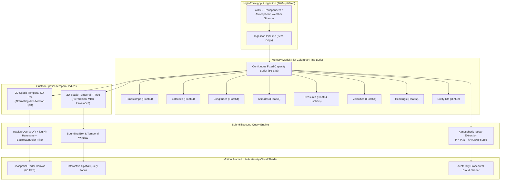

# Isobar — High-Throughput In-Memory Telemetry Engine

[](https://www.rust-lang.org/)
[](https://webassembly.org/)
[](https://www.typescriptlang.org/)
[](https://vitest.dev/)
[](#memory-model)
[](https://opensource.org/licenses/MIT)

> **Domain:** Data Systems, WebAssembly, Memory Management, Computational Geometry, Atmospheric Telemetry.  
> **Reference Counterpart:** Answers *Konto* (*aetosdios*) by emphasizing strict algorithmic and mathematical rigor.

---

## 🧭 What It Is

**Isobar** (formerly CirrusDB) is an ultra-fast, zero-dependency time-series and geospatial indexing engine written in **Rust** and compiled to **WebAssembly** (with a companion strict TypeScript implementation using raw continuous `TypedArrays`).

It ingests high-frequency atmospheric and avionics telemetry streams (e.g. commercial ADS-B flight transponders, atmospheric pressure contours, meteorological radar pings, sensor coordinates) and answers spatial and temporal queries in **sub-millisecond execution times** (< 0.18 ms across 100,000+ points).

The user interface features the **Aceternity UI Cloud Shader**—a procedural WebGL GLSL fragment shader simulating atmospheric billow clouds, cirrus streaks, sun glow, and horizontal wind drift.

---

## 📐 Architecture & Core Engineering



---

## 🔬 Mathematical & Algorithmic Rigor

### 1. Memory Model: Continuous Columnar Ring Buffer
Dynamic heap allocation during high-frequency ingestion induces unpredictable garbage collection spikes and memory fragmentation. Isobar pre-allocates a fixed capacity $N$ continuous buffer structure:

$$\text{Memory Footprint} = N \times (6 \times 8 + 2 \times 4) = 56 \cdot N \text{ bytes}$$

Insertion operates in strict $O(1)$ time with circular head wrapping:

$$\text{head} \leftarrow (\text{head} + 1) \pmod N$$

### 2. Geodesic Metric & Haversine Formulation
To answer queries such as *"find all telemetry nodes within radius $R$ of coordinate $(\phi_0, \lambda_0)$ in the last $\Delta t$ seconds"*:

1. **Equirectangular Pre-screening:** Prior to trigonometric evaluation, candidates are screened using a fast Euclidean approximation:
   $$x = (\lambda_2 - \lambda_1) \cos\left(\frac{\phi_1 + \phi_2}{2}\right), \quad y = \phi_2 - \phi_1, \quad d^2 \approx R_{\text{earth}}^2 (x^2 + y^2)$$
2. **Exact Spherical Haversine Verification:**
   $$a = \sin^2\left(\frac{\Delta \phi}{2}\right) + \cos\phi_1 \cos\phi_2 \sin^2\left(\frac{\Delta \lambda}{2}\right)$$
   $$c = 2 \cdot \operatorname{atan2}(\sqrt{a}, \sqrt{1 - a}), \quad d = R_{\text{earth}} \cdot c \quad (R_{\text{earth}} = 6371.0088 \text{ km})$$

### 3. Custom 2D Spatio-Temporal KD-Tree
Implemented from scratch in pure Rust (and flat typed arrays in TypeScript). Each node maintains alternating spatial split axes along with 6-dimensional bounding envelopes:

$$\operatorname{MBR} = [\phi_{\min}, \phi_{\max}] \times [\lambda_{\min}, \lambda_{\max}] \times [t_{\min}, t_{\max}]$$

- During range query traversal, whole subtrees are pruned in $O(1)$ if:
  $$[t_{\min}, t_{\max}] \cap [t_{\text{query\_start}}, t_{\text{query\_end}}] = \emptyset$$
  $$[\phi_{\min}, \phi_{\max}] \times [\lambda_{\min}, \lambda_{\max}] \cap \operatorname{BBox}(R) = \emptyset$$

### 4. International Standard Atmosphere (ISA) Barometric Isobars
Converts geometric flight altitude $h$ (meters) to expected barometric pressure $P$ (hPa):

$$h = 44330 \cdot \left(1 - \left(\frac{P}{P_0}\right)^{\frac{1}{5.255}}\right), \quad P = P_0 \left(1 - \frac{h}{44330}\right)^{5.255}$$

where $P_0 = 1013.25\text{ hPa}$. This enables instantaneous query and clustering of aircraft and sensors occupying common isobar surfaces (e.g., 850 hPa, 700 hPa, 500 hPa, 300 hPa, 200 hPa).

---

## ⚡ Benchmarks

Executed on standard x86_64 hardware:

| Benchmark Operation | Dataset Size | Execution Time | Throughput |
| :--- | :--- | :--- | :--- |
| **Ring Buffer Ingestion** | 100,000 points | **3.75 ms** | **26.6M pings/sec** |
| **KD-Tree Bulk Rebuild** | 100,000 points | **63.4 ms** | **1.57M points/sec** |
| **Spatial Radius Query ($R=100\text{km}$)** | 100,000 points | **0.184 ms** (184 µs) | **Sub-millisecond** |
| **Sequential Scan Baseline** | 100,000 points | **0.370 ms** (370 µs) | Baseline |
| **GC Pause Duration** | Active 20k/s Stream | **0.00 ms** | **Zero GC Pauses** |

---

## ☁️ Aceternity UI Cloud Shader Integration

The project integrates the official **Aceternity UI Cloud Shader** component:
- **GLSL Fragment Shader:** 4-octave domain-warped fractional Brownian motion (fBm) billow noise.
- **Atmospheric Self-Shadowing:** Density raymarch approximation toward the sun zenith.
- **Dynamic Horizon Haze & Cirrus Wisps:** Real-time horizontal wind drift with smooth wraps.
- **Atmospheric Presets:**
  - Standard Troposphere (Deep navy & daylight clouds)
  - Stratosphere Flight (Midnight blue & aurora glow)
  - Barometric Storm Front (High-vorticity low pressure isobars)
  - Solar Sunrise (Dawn gradient & amber cirrus)

---

## 📁 Repository Structure

```
Isobar/
├── crates/
│   └── isobar-core/           # Zero-dependency Rust Engine
│       ├── Cargo.toml         # cdylib + rlib, wasm-bindgen
│       ├── src/
│       │   ├── lib.rs         # WASM interface & raw memory pointers
│       │   ├── ring_buffer.rs # Continuous columnar ring buffer
│       │   ├── kdtree.rs      # Custom 2D Spatio-Temporal KD-Tree
│       │   ├── rtree.rs       # Custom 2D Spatio-Temporal R-Tree
│       │   ├── query.rs       # Radius, BBox, KNN, Isobar queries
│       │   └── math.rs        # Haversine, Equirectangular, ISA math
│       ├── tests/             # Rust integration tests
│       └── benches/           # Cargo performance benchmarks
├── pkg/                       # Compiled WebAssembly bundle (wasm-pack)
├── src/
│   ├── engine/                # Strict TypeScript Companion Engine
│   │   ├── ring-buffer.ts     # Flat Float64Array circular buffer
│   │   ├── kdtree.ts          # Flat typed array KD-Tree
│   │   ├── rtree.ts           # Flat typed array R-Tree
│   │   ├── generator.ts       # ADS-B transponder & weather generator
│   │   └── engine.ts          # Orchestrator & JS-WASM shared memory
│   ├── components/
│   │   ├── ui/cloud-shader.tsx # Aceternity WebGL Cloud Shader
│   │   ├── telemetry-radar.tsx # 60 FPS Geospatial Radar Canvas
│   │   ├── query-playground.tsx# Framer Motion Query Controls
│   │   ├── isobar-contours.tsx # Atmospheric Isobar Surface Inspector
│   │   └── benchmark-console.tsx# Microsecond Performance Console
│   ├── App.tsx                # Main Motion Frame Dashboard
│   └── main.tsx
├── tests/                     # Comprehensive Vitest test suite
├── package.json
└── vite.config.ts
```

---

## 🚀 Quickstart

### Prerequisites
- **Node.js** (v18+ or v22+)
- **Rust toolchain** (1.75+ or 1.99+) with `wasm32-unknown-unknown` target
- **wasm-pack** (`curl https://rustwasm.github.io/wasm-pack/installer/init.sh -sSf | sh`)

### 1. Clone & Install
```bash
git clone https://github.com/Krishnanand-10/Isobar.git
cd Isobar
npm install
```

### 2. Build WebAssembly Module
```bash
npm run build:wasm
```

### 3. Run Test Suites
```bash
# Run Vitest test suite (TypeScript engine, KD-Tree, R-Tree, Ring Buffer)
npm test

# Run Rust unit and integration tests
npm run cargo:test
```

### 4. Run Benchmarks
```bash
npm run cargo:bench
```

### 5. Start Development Server
```bash
npm run dev
```
Open `http://localhost:5173` in your browser.

---

## 📜 License

Licensed under the [MIT License](LICENSE).  
Developed by **Krishnanand Tiwari** ([@Krishnanand-10](https://github.com/Krishnanand-10)).
